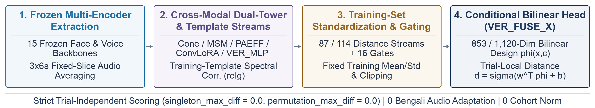

# FLAG 2027 Challenge: System Description & Compliance Questionnaire

**Face-voice Association across LAnguages and Gender**

Completed for the submission corresponding to our best FLAG 2027 evaluation result (`#1057629` / `#1057627`). All information provided below is strictly consistent with our submitted code repository and 2-page system description.

## A. Team and Submission Information

### 1. Team name:
`susupro`

### 2. Team representative name and e-mail:
Yan Su (`hi@yansu.me` / `y-su24@mails.tsinghua.edu.cn`)

### 3. Number of team members:
1

### 4. CodaBench team/user name:
`susupro`

### 5. Final evaluation score:
**2.13%** displayed mean EER (**2.129763%** exact mean EER across the four official evaluation protocols):
- `no_gender / English`: **1.530612%** (392 trials)
- `no_gender / Bangla`: **1.745636%** (802 trials)
- `gender / English`: **3.846154%** (416 trials)
- `gender / Bangla`: **1.396648%** (716 trials)

## B. System Overview

### 6. Briefly describe your final system. Summarize the main face encoder, voice encoder, face-voice association method, and scoring strategy.
Our system (**VER-FUSE-X: Multi-Scale Cross-Modal Dual-Tower Metric Learning and Training-Template Spectral Correlation with Conditional Bilinear Fusion**) scores each face-voice trial $(f_i, v_i)$ strictly independently in three stages:
1. **Frozen Multi-Encoder Representation Extraction**: On the visual side, we extract $\ell_2$-normalized embeddings from frozen pretrained face backbones (`InsightFace AntelopeV2`, `Buffalo_L`, `AdaFace IR-101`, `VGGFace`, `FaRL ViT-B/16`, `CLIP ViT-L/14`) and frozen facial age/gender attributes (`ViT-Age`, `InsightFace genderage`). On the acoustic side, we apply deterministic fixed-duration sub-slice averaging ($K=3$ uniform $6.0\,\text{s}$ windows at $16\,\text{kHz}$, FAQ #13) over frozen pretrained speaker and paralinguistic encoders (`WeSpeaker VoxBlink2 ResNet293`, `SimAM-ResNet100`, `IDRnD ReDimNet-B2`, `ReDimNet-v2`, `WavLM-Large`, `SpeechBrain ECAPA-TDNN`, `audEERING wav2vec2-large-robust-24-ft-age-gender`, and `ImageBind-Huge`).
2. **Cross-Modal Dual-Tower Metric Networks & Training-Template Spectral Correlation ($\rho_{\text{relg}}$)**: To eliminate embedding-cone anisotropy without any test-time cohort normalization, we train five complementary high-dropout ($p \in [0.30, 0.91]$) cross-modal projection and pair-discrimination modules (`ConeTower` with internal `BatchNorm1d`, `MSM` simplex-separated projection, `PAEFF` hyperbolic Poincare distance with gated 1D convolution, `ConvLoRA` 1D-convolutional low-rank residual projection, and `VER_MLP` bilinear pair discriminator $g([u, w, u\odot w, |u-w|])$) combined with whitened speaker-centroid orthogonal Procrustes projections on non-Bengali speakers. To neutralize unseen-language shift in Bengali while remaining 100% trial-independent, we project each test face $f_i$ and voice $v_i$ onto a fixed dictionary of training-set South Asian speaker centroids ($T_f, T_v$) and compute their zero-mean weighted Pearson response correlation $\rho_{\text{relg}}(f_i, v_i)$.
3. **Second-Order Conditional Bilinear Scoring (`VER_FUSE_X`)**: For each trial, the multi-stream cross-modal distances ($87$ streams for `no_gender`, $114$ streams for `gender`) are standardized using fixed training-set means and standard deviations (`xmean`, `xsd`) and combined with $16$ frozen demographic/acoustic conditioning variables $c$ (including gender-consistency and age-consistency terms per FAQ #10 to #12) and their outer-product interaction terms $\tilde{x} \otimes g$ via a fixed protocol/language conditional bilinear head $d(f_i, v_i) = \sigma(w^\top \phi(x_i, c_i) + b)$. Lower scores indicate higher same-speaker confidence.

### 7. Please provide or attach a diagram illustrating the overall system architecture.
An architectural block diagram illustrating the complete trial-independent pipeline (Stage 1: Frozen Multi-Encoder & Fixed-Slice Audio Extraction -> Stage 2: Cross-Modal Dual-Tower Metric Projection & Fixed Training-Template Spectral Correlation -> Stage 3: Training-Set Standardization & Demographic Gating -> Stage 4: Second-Order Conditional Bilinear Fusion `VER_FUSE_X`) is embedded below and included in `figures/architecture_compact.png` and Figure 1 of `system_description_2p.pdf`.

### 8. Did you use the FLAG 2027 baseline system or any part of its implementation? If yes, please specify which components.
**Yes**

We built upon the official FLAG 2027 FOP/MSM baseline paradigm, specifically adopting its orthogonal cross-modal projection formulation (`CE + OPL` orthogonal projection loss and high feature-level dropout regularization) as one of our dual-tower branches, as well as the official evaluation trial list parser and `<pair_id> <distance>` submission verification interface (`verify_submission.py`).

### 9. Which pretrained face and voice encoders did you use? For each encoder, provide its name, source/checkpoint, pretraining dataset if known, and indicate whether it was frozen or fine-tuned.

All pretrained unimodal face, speaker, and demographic encoders were kept **strictly frozen** (`eval()` mode, `requires_grad=False`). None of the audio encoders were ever trained, fine-tuned, or adapted on Bengali speech. For `ImageBind-Huge`, the multimodal backbone remained completely frozen, and an auxiliary rank-4 audio projection adapter was trained exclusively on non-Bengali audio-visual pairs.

| Encoder Name | Modality | Source Repository / Checkpoint | Pretraining Dataset | Status |
| :--- | :--- | :--- | :--- | :--- |
| **InsightFace AntelopeV2 (ResNet100)** | Face | `deepinsight/insightface` (`antelopev2`) | Glint360K | **Frozen** |
| **InsightFace Buffalo_L (ArcFace-R100)** | Face | `deepinsight/insightface` (`buffalo_l`) | WebFace600K | **Frozen** |
| **AdaFace IR-101** | Face | `mk-minchul/AdaFace` (`adaface_ir101_webface12m`) | WebFace12M | **Frozen** |
| **VGGFace** | Face | `ox-vgg/vgg_face` | VGGFace / VGGFace2 | **Frozen** |
| **FaRL ViT-B/16** | Face | `FacePerceiver/FaRL` (`FaRL-Base-Patch16-LAIONFace20M-ep16.pth`) | LAION-Face 20M | **Frozen** |
| **CLIP ViT-L/14** | Face | `openai/clip-vit-large-patch14` | WIT-400M | **Frozen** |
| **ViT Facial Age Classifier** | Face (Demographic) | `nateraw/vit-age-classifier` | FairFace | **Frozen** |
| **WeSpeaker VoxBlink2 ResNet293** | Voice | `wenet-e2e/wespeaker` (`voxblink2_samresnet293`) | VoxBlink2 + VoxCeleb2 | **Frozen** |
| **WeSpeaker SimAM-ResNet100** | Voice | `wenet-e2e/wespeaker` (`voxblink2_samresnet100`) | VoxBlink2 + VoxCeleb2 | **Frozen** |
| **IDRnD ReDimNet-B2** | Voice | `IDRnD/ReDimNet` (`ReDimNet-B2-vox2`) | VoxCeleb2 | **Frozen** |
| **IDRnD ReDimNet-v2** | Voice | `IDRnD/ReDimNet` (`ReDimNet-v2`) | VoxCeleb2 + VoxBlink2 | **Frozen** |
| **Microsoft WavLM-Large SV** | Voice | `microsoft/wavlm-large` | 94k hrs English + VoxCeleb2 | **Frozen** |
| **SpeechBrain ECAPA-TDNN** | Voice | `speechbrain/spkrec-ecapa-voxceleb` | VoxCeleb1 + VoxCeleb2 | **Frozen** |
| **audEERING Age & Gender** | Voice (Demographic) | `audeering/wav2vec2-large-robust-24-ft-age-gender` | aGender / Common Voice / Timit | **Frozen** |
| **ImageBind-Huge** | Multimodal | `facebookresearch/ImageBind` (`imagebind_huge.pth`) | AudioSet / SUN RGB-D / LAION | **Frozen backbone** (+ non-Bengali audio projection) |

### 10. Apart from pretrained encoders, what components of your system were trained specifically for FLAG 2027?
Only the upper-level cross-modal association and fusion components were trained specifically for FLAG 2027 on top of the frozen encoder embeddings:
1. **Cross-Modal Dual-Tower Metric & Pair Discrimination Networks (`models.py`, `train_network.py`)**: `ConeTower` (`BatchNorm1d` cone-elimination dual towers with `Dropout=0.75`), `MSM` (simplex-targeted cross-modal projection with `Dropout=0.91`), `PAEFF` (Poincare hyperbolic distance + 1D gated convolution), `ConvLoRA` (1D convolutional low-rank residual projection towers), and `VER_MLP` (end-to-end bilinear pair discriminator $[u, w, u\odot w, |u-w|]$ trained with same-gender hard-negative `BCE + PK-InfoNCE` loss).
2. **Closed-Form Orthogonal Procrustes & Training-Template Spectral Operators (`extract_features.py`)**: Speaker-centroid whitened orthogonal Procrustes transformations (both global and within-gender centered) and fixed South Asian training-template response matrices ($T_f, T_v$) for trial-independent spectral correlation ($\rho_{\text{relg}}$).
3. **Second-Order Conditional Bilinear Fusion Heads (`VER_FUSE_X`, `core.py`, `train.py`)**: Regularized conditional bilinear scoring heads (`assets/*-head.npz`) combining standardized distance streams, demographic/acoustic conditioning gates, and second-order stream-gate interactions.

## C. Training Data

### 11. Which FLAG 2027 training data did you use? Indicate whether you used the complete official training set or a subset, and describe any filtering or pruning.
We used the **complete official FLAG 2027 `v4` English training set** (`data/train_set.zip`, comprising all **70 training identities** `id001` to `id070` and **6,485 face-voice pairs** across 4,029 unique voice segments). No speakers were pruned; during cross-modal dual-tower training and 5-fold speaker-disjoint cross-validation, positive pairs were sampled across distinct voice recordings ($r(f_i) \neq r(v_i)$) to prevent same-clip channel memorization.

### 12. Did you use any external datasets? If yes, list every dataset and explain exactly how each dataset was used.
**Yes**

In strict compliance with FAQ #6 to #9 and #19 to #21, we used two publicly accessible, non-Bengali audiovisual datasets to train the cross-modal dual-tower metric projections and validate cross-lingual generalization:
1. **MAV-Celeb v1 (English/Urdu, 64 identities) & MAV-Celeb v2 (English/Hindi, 87 identities)** (`https://mavceleb.github.io/dataset/`): After speaker-level identity deduplication against the evaluation set, the **151 South Asian non-Bengali speakers** (68 Urdu/English and 83 Hindi/English, 10,649 face images and 7,058 voice utterances) were used to (a) construct the fixed South Asian training-template dictionary ($T_f, T_v$) for the spectral correlation operator $\rho_{\text{relg}}$, (b) co-train the cross-modal metric towers on South Asian facial structure and vocal tract characteristics, and (c) serve as our **Leave-Language-Out (`English -> Urdu/Hindi`)** speaker-disjoint validation benchmark for selecting unheard-language fusion hyperparameters.
2. **VoxCeleb2 Non-Bengali Subset (4,875 identities, 48,750 utterance pairs)** (`https://www.robots.ox.ac.uk/~vgg/data/voxceleb/vox2.html`): All speakers predicted or annotated as Bengali (`bn`) were completely excluded at the whole-speaker level. The non-Bengali speaker utterances were used to pre-stabilize the 5,096-speaker cross-modal dual-tower projections (`ConeTower`, `MSM`, `PAEFF`, `ConvLoRA`, `VER_MLP`) and same-segment recording consistency heads before calibrating BatchNorm statistics on the official South Asian training speakers.

### 13. Was any Bengali speech used to train, fine-tune, or adapt an audio encoder? If yes, provide details.
**No**

No Bengali speech was ever used to train, fine-tune, or adapt any audio encoder. All pretrained audio encoders were executed strictly frozen, and any speaker associated with Bengali speech in external datasets was removed at the whole-speaker level.

### 14. Did you perform any data augmentation? If yes, describe all augmentation methods and the modalities to which they were applied.
**Yes**

1. **Embedding-Level High-Rate Feature Dropout (Face & Voice Modalities, Training Only)**: During cross-modal dual-tower training (`train_network.py`), we applied high-probability feature-level dropout ($p \in \{0.30, 0.40, 0.50, 0.75, 0.91\}$ across different architectural branches) and cross-recording positive pair sampling (pairing a face frame from one recording with a voice segment of the same identity from a distinct recording) to prevent modality-cone overfitting.
2. **Deterministic Fixed-Slice Audio Embedding Averaging (Voice Modality, Training & Inference per FAQ #13)**: In `extract_features.py`, each audio waveform is deterministically partitioned into $K=3$ uniformly spaced $6.0\,\text{s}$ sub-slices at $16\,\text{kHz}$ (with periodic padding for clips shorter than $6.0\,\text{s}$). Each sub-slice is independently encoded and $\ell_2$-normalized, and the resulting slice vectors are averaged and $\ell_2$-normalized into a single trial representation without accessing any other trial.

### 15. How did you perform model selection and hyperparameter tuning? Specify the validation data and criteria used.
All model selection, stream weighting, ridge regularization tuning ($\lambda \in \{0.1, 1.0, 10.0\}$), and conditioning gate selection were performed exclusively on training and development validation splits using two complementary speaker-disjoint rulers (`train.py`):
1. **5-Fold Speaker-Disjoint Cross-Validation on Official FLAG `v4` Training Data (70 Speakers)**: The 70 official training identities (`id001` to `id070`) were partitioned into 5 mutually exclusive speaker folds (14 held-out identities per fold). In each fold, any trial containing a held-out identity at either endpoint was strictly excluded from training and standardization fitting; evaluation was performed on synthetic `no_gender` and `gender` (same-gender negative) trial lists constructed exclusively among the 14 held-out speakers.
2. **Leave-Language-Out (`English -> Urdu/Hindi`) Speaker-Disjoint Validation on `MAV-Celeb v1/v2`**: To select hyperparameters for the `Bangla_unheard` track without touching Bengali data or evaluation trials, models fitted on English training folds were evaluated on speaker-disjoint Urdu (`MAV-Celeb v1`) and Hindi (`MAV-Celeb v2`) `no_gender` and `gender` trial lists, optimizing mean Equal Error Rate (EER).

## D. Final Scoring System

### 16. Is your final submission based on a single model or an ensemble? If an ensemble was used, list all constituent models and explain how their scores were combined.
Our final submission is an **ensemble of multi-encoder cross-modal metric streams** combined via a **fixed-weight Second-Order Conditional Bilinear Fusion Head (`VER_FUSE_X`, `core.py`)**:
- **Constituent Streams ($87$ streams for `no_gender`, $114$ streams for `gender`)**:
  1. **Whitened Orthogonal Procrustes & Dual-Ridge Streams**: Bidirectional speaker-centroid dual ridge and SVD orthogonal Procrustes cosine distances across the frozen face and voice encoder banks (including within-gender centered Procrustes projections for the `gender` protocol).
  2. **Deep Cross-Modal Dual-Tower Streams (`ConeTower`, `MSM`, `PAEFF`, `ConvLoRA`, `VER_MLP`)**: Cosine, Poincare hyperbolic, and bilinear pair-discrimination distances trained on the 5,096-speaker non-Bengali utterance bank.
  3. **South Asian Training-Template Spectral Correlation Streams ($\rho_{\text{relg}}$)**: Zero-mean weighted Pearson correlation between face and voice response profiles over fixed training-set South Asian speaker centroids ($T_f, T_v$).
  4. **Same-Segment Recording Consistency & Frozen Demographic Streams**: Audio-visual scene/channel consistency scores and explicit frozen gender/age disagreement penalties (`gender_disagreement`, `age_gap`).
- **Combination Rule (`core.py`)**: For a single trial with distance vector $x$ and 16-dimensional conditioning vector $c$, each stream is standardized using fixed training-set statistics $\tilde{x}_j = \operatorname{clip}((x_j - \mu_j)/\sigma_j, -8, 8)$ and $\tilde{c}_k = \operatorname{clip}((c_k - \mu_{c,k})/\sigma_{c,k}, -5, 5)$. Taking the first 8 conditioning variables as gate vector $g = \tilde{c}_{1:8}$, we form the conditional bilinear feature vector $\phi(x, c) = [\tilde{x}, \tilde{c}, o_{\mathcal{A}}, \operatorname{vec}(\tilde{x} g^\top)] \in \mathbb{R}^{D}$ ($D=853$ for `no_gender`, $D=1,120$ for `gender`) and compute the final distance via fixed linear weights and sigmoid link:
  $$d(x, c) = \sigma(w^\top \phi(x, c) + b).$$

### 17. Did you use different models or sub-ensembles for English and Bengali evaluation lists or for the gender and no_gender protocols? If yes, describe the selection procedure and how these systems were fixed before evaluation.
**Yes**

We trained four fixed conditional bilinear fusion heads (`assets/no_gender_English-head.npz`, `assets/no_gender_Bangla-head.npz`, `assets/gender_English-head.npz`, `assets/gender_Bangla-head.npz`) tailored to the structural properties of the two protocols and two language tracks:
- **`no_gender` vs. `gender` Protocol Separation**: Because negative pairs in the `gender` protocol are drawn strictly from same-gender speakers, cross-gender shortcut streams have zero discriminative power there and are replaced by within-gender centered Procrustes operators, fine-grained facial/vocal age-distribution alignment (`vitageprob` $\times$ `audeering`), and same-gender hard-negative `VER_MLP` streams ($114$ streams in `gender` vs. $87$ streams in `no_gender`, while explicit `gender_disagreement` log-odds terms are active in `no_gender` per FAQ #11).
- **Heard (`English`) vs. Unheard (`Bangla`) Language Selection**: For the heard `English` track, fusion weights were optimized directly on the 5-fold speaker-disjoint CV of the official `v4` English training set. For the unheard `Bangla` track, fusion weights emphasized language-invariant South Asian training-template spectral correlation streams ($\rho_{\text{relg}}$) and were selected via Leave-Language-Out (`English -> Urdu/Hindi`) cross-validation on `MAV-Celeb v1/v2`. All four heads (`w`, `bias`, `xmean`, `xsd`, `cmean`, `csd`) were frozen into `assets/*-head.npz` prior to running evaluation inference.

### 18. Did you use auxiliary demographic information or predictors, such as gender or age? If yes, describe the models, how their outputs were incorporated into the final score, and how any associated weights were selected.
**Yes**

In strict accordance with FAQ #10 to #12, we used completely frozen public demographic predictors:
1. **Frozen Models**: `InsightFace genderage` (`buffalo_l` / `antelopev2`), `nateraw/vit-age-classifier` (9-bin facial age distribution `vitageprob`), and `audeering/wav2vec2-large-robust-24-ft-age-gender` (continuous vocal age `w2v2agage` and 3-class vocal gender/child distribution `w2v2aggen`).
2. **Incorporation into Final Score**: The frozen demographic outputs provide (a) an explicit gender-consistency distance term $p_{\text{face}}(\text{male})(1 - p_{\text{voice}}(\text{male})) + (1 - p_{\text{face}}(\text{male}))p_{\text{voice}}(\text{male})$ for the `no_gender` protocol (FAQ #11), (b) an explicit age-consistency term $|a_{\text{face}} - a_{\text{voice}}|$ across both `no_gender` and `gender` protocols (FAQ #12), and (c) the conditioning gate variables $g$ in the bilinear design $\phi(x, c) = [\tilde{x}, \tilde{c}, o_{\mathcal{A}}, \operatorname{vec}(\tilde{x} g^\top)]$, allowing the linear head to smoothly weight acoustic and visual identity streams according to speaker demographic confidence.
3. **Weight Selection**: All weights on the demographic consistency terms and conditioning gates were learned jointly within the regularized linear head $w$ via 5-fold speaker-disjoint CV and Leave-Language-Out CV on the training sets and kept completely fixed at inference.

### 19. Did your final scoring procedure use score normalization, calibration, cohort normalization, Z/T/S-Norm, CSLS-style normalization, or any similar post-processing? If yes, provide full details.
**No**

Our final scoring procedure uses **no post-hoc score normalization, no cohort normalization, no Z-Norm, T-Norm, S-Norm, AS-Norm, or CSLS-style normalization** (even with training-set cohorts, strictly adhering to FAQ #4). In `core.py`, each trial's feature vector is standardized solely by fixed per-feature mean and standard deviation constants (`xmean`, `xsd`, `cmean`, `csd`) pre-computed on the training data, projected by the fixed weight vector `w` and `bias`, and mapped to $(0, 1)$ by the element-wise logistic sigmoid function $\sigma(\cdot)$.

### 20. Did your system compute any statistics, clusters, nearest-neighbour relationships, graphs, pseudo-labels, or other information jointly from progress/evaluation samples? If yes, provide full details.
**No**

No statistics, means, variances, clusters, nearest-neighbor graphs, co-occurrence matrices, pseudo-labels, or transductive adjustments are ever computed jointly across progress or evaluation samples (FAQ #1 to #3).

### 21. Can every evaluation trial be scored independently without accessing other evaluation trials? If no, please explain.
**Yes**

Every evaluation trial is scored 100% independently in a stateless, trial-local forward pass (`core.independent_predict`). Our inference script `run.py` automatically runs two mathematical invariance audits across all 4 evaluation lists (2,326 trials):
1. **Singleton Independence (`batch_size=1`)**: Scoring each trial one by one in isolation yields `singleton_max_diff = 0.0` compared to batch array execution across all 4 cells.
2. **Permutation Invariance**: Randomly shuffling the order of the evaluation trial list yields `permutation_max_diff = 0.0` across all 4 cells.

### 23. Were any model parameters, ensemble weights, thresholds, normalization parameters, demographic-term weights, or other scoring parameters selected or modified using progress/evaluation scores or evaluation-set information? If yes, provide details.
**No**

All model parameters, standardization statistics, demographic consistency weights, and bilinear fusion coefficients were determined on the training and cross-lingual validation splits and frozen in `assets/*-head.npz` prior to evaluation scoring.

## E. Reproducibility

### 24. Please provide the GitHub repository containing the complete training and inference pipeline.
- **GitHub Repository**: `https://github.com/logxio/flag2027-susupro` (Collaborator access invited for `usmangrewal@gmail.com`).

### 25. Does the repository include all of the following: environment/dependency specification, training scripts, evaluation/inference scripts, configuration files, required checkpoints, and instructions for reproducing the submitted system?
**Yes**

The repository includes environment specifications (`requirements.txt`, `requirements-training.txt`, `Dockerfile`), feature extraction and fixed-slice averaging scripts (`extract_features.py`), cross-modal dual-tower and conditional bilinear fusion training scripts (`train.py`, `train_network.py`, `models.py`, `model_inference.py`), configuration files (`configs/flag2027_config.yaml`, `configs/encoder_inventory.json`), required checkpoints and pre-extracted feature tensors (`assets/*-head.npz`, `assets/*-indep-input.npz`), official verification utility (`verify_submission.py`), and step-by-step execution instructions (`README.md`).

### 26. Does the submitted code reproduce the system corresponding to your best CodaBench evaluation submission?
**Yes**

Running `python run.py` executes the pure trial-independent matrix forward pass (`core.independent_predict`) and reproduces all 2,326 trial scores of our best CodaBench submission `#1057629` / `#1057627` (**2.13%** displayed EER, **2.129763%** exact mean EER; `SHA256: 69a660f98b09fe1c7071a01329b87769b1972e548d5db59269d2e7e82eeee8bf`) in under 2 seconds on CPU.

### 27. Are all external datasets, pretrained models, checkpoints, and other resources required to reproduce the system accessible to the FLAG 2027 organizers? If no, specify which resources cannot be provided.
**Yes**

All external datasets (`VoxCeleb2`, `MAV-Celeb v1/v2`), public pretrained encoder repositories (`InsightFace`, `AdaFace`, `FaRL`, `CLIP`, `WeSpeaker VoxBlink2`, `ReDimNet`, `WavLM-Large`, `SpeechBrain`, `audEERING`, `ImageBind`), and our trained fusion checkpoints (`assets/*-head.npz`) are publicly accessible and documented in `configs/encoder_inventory.json` and `README.md`.

## G. Compliance Declaration

### 28. Have you carefully read the FLAG 2027 Evaluation Plan and subsequent FAQ/rule clarifications?
**Yes**

### 29. Do you confirm that your final submitted system complies with all FLAG 2027 rules, including restrictions concerning test-set processing, transductive inference, score normalization, Bengali-based audio-encoder adaptation, and evaluation-data-based parameter tuning?
**Yes**

### 30. Do you confirm that the code and system description provided to the organizers accurately represent the system used for your reported best evaluation result?
**Yes**

**Team Representative**: Yan Su  
**Date**: 19 November 2026  

*FLAG 2027 | IEEE ICASSP 2027 | Contact: mavceleb@gmail.com*
